<div align="center">

<!-- ============================ HEADER ============================ -->


<br/>

<!-- ========================= TYPING ANIMATION ========================= -->


<br/><br/>

<a href="mailto:gonzalofll100@gmail.com">
  
</a>
<a href="https://github.com/GonzaloFalcon">
  
</a>


</div>

<br/>

##  About me

<div align="center">

<!-- Tarjeta de código con la paleta del tema (SVG propio: GitHub no permite recolorear bloques de código) -->


</div>

<details>
<summary><b>Ver el código como texto plano</b></summary>

```typescript
const gonzalo = {
  nombre: "Félix Gonzalo Falcón Llanos",
  rol: ["Facturación electrónica", "Soporte técnico"],
  empresa: "RUBRIFACT S.A.C.",
  estudios: "Ingeniería de Sistemas",
  stack: {
    sistemas: ["Rust", "Tauri"],
    web: ["React", "TypeScript"],
    movil: ["Flutter", "Dart"],
    datos: ["MongoDB"],
  },
  entorno: ["Debian", "CachyOS", "Windows 11"],
  estado: "Construyendo software fiable",
} as const;
```

</details>

---

##  At a glance

<table>
<tr>
<td width="48%" valign="middle">

**Currently**

- 🔭 Desarrollando herramientas de **facturación electrónica**
- 🦀 Construyendo aplicaciones de escritorio con **Rust + Tauri**
- 🛠️ Analista de **soporte técnico** en RUBRIFACT
- 🎓 Estudiando **Ingeniería de Sistemas**

**Principles**

- Rendimiento antes que comodidad
- Binarios livianos, arranque instantáneo
- Software que aguanta producción real

</td>
<td width="52%" valign="middle" align="center">



</td>
</tr>
</table>

---

##  Technology Stack

<div align="center">

### Languages & Frameworks


### Databases & Infrastructure


### Development Environment


</div>

---

##  Areas of Interest

<table>
<tr>
<td width="50%" valign="top">

### Backend & Systems

- Rust development
- Tauri desktop applications
- API development
- Database management
- Performance optimization

</td>
<td width="50%" valign="top">

### Frontend & Mobile

- React and TypeScript
- Flutter and Dart
- Responsive interfaces
- Software architecture
- User experience

</td>
</tr>
</table>

---

##  Featured Project

<div align="center">

### AndesGuard

> Herramientas de escritorio confiables, con foco en rendimiento, seguridad y usabilidad.


<br/><br/>

<a href="https://github.com/GonzaloFalcon">
  
</a>

</div>

---

##  GitHub Activity

<div align="center">


<br/><br/>


<br/><br/>


</div>

---

<div align="center">

### Engineering is about building solutions that last.

<sub>Reliability is not a feature. It is the starting point.</sub>

<br/><br/>


<br/>


</div>
