<div align="center">

<!-- ============================ HEADER (Monokai) ============================ -->


<br/>

<!-- ========================= TYPING ANIMATION ========================= -->


<br/><br/>

<a href="mailto:gonzalofll100@gmail.com">
  
</a>
<a href="https://github.com/GonzaloFalcon">
  
</a>


</div>

<br/>

##  Sobre mí

<div align="center">

<!-- Tarjeta de código con la paleta del tema (SVG propio: GitHub no permite recolorear bloques de código) -->


</div>

<details>
<summary><b>Ver el código como texto plano</b></summary>

```typescript
const gonzalo = {
  nombre: "Félix Gonzalo Falcón Llanos",
  rol: ["Desarrollador Dev, Facturación electrónica", "Soporte técnico"],
  empresa: "RUBRIFACT S.A.C.",
  estudios: "Ingeniería de Sistemas",
  stack: {
    sistemas: ["Rust", "Tauri"],
    web: ["React", "TypeScript", "JavaScript", "PHP"],
    movil: ["Flutter", "Dart", "React-Native"],
    datos: ["MongoDB", "PostgreSQL", "MySQL"]
  },
  entorno: ["Debian", "CachyOS", "Windows"],
  estado: "Construyendo software fiable",
} as const;
```

</details>

---

##  De un vistazo

<table>
<tr>
<td width="22%" align="center" valign="middle">
  
</td>
<td width="78%" valign="middle">

Desarrollador de Software y Analista de Soporte Técnico especializado en <kbd>sistemas de facturación electrónica</kbd>, con una sólida trayectoria en el <kbd>Desarrollo Full Stack</kbd> orientada a la arquitectura y despliegue integral de <kbd>soluciones tecnológicas de alto rendimiento</kbd>. Su enfoque combina el dominio de tecnologías nativas y multiplataforma para diseñar, construir y mantener sistemas robustos tanto en el <kbd>backend</kbd> como en el <kbd>frontend</kbd>, garantizando la <kbd>escalabilidad</kbd>, la <kbd>seguridad</kbd> y la optimización de procesos críticos de negocio.

</td>
</tr>
</table>

<br/>

<div align="center">

### "La ingeniería consiste en crear soluciones que perduren".

<sub>La fiabilidad no es una característica. Es el punto de partida.</sub>

<br/>



</div>

---

##  Tecnologías

<div align="center">

### Languages & Frameworks


### Databases & Infrastructure


### Development Environment


</div>

---

##  Areas of Interest

<table>
<tr>
<!-- Columna 1: Backend & Systems -->
<td width="50%" valign="top">

### Backend & Systems

- **Rust development:** Aplicaciones seguras y de alto rendimiento.
- **Tauri desktop:** Desarrollo de software de escritorio nativo.
- **API development:** Integración y servicios web robustos.
- **Database management:** Gestión de datos con MongoDB Atlas.
- **Performance optimization:** Arquitectura y procesos eficientes.

</td>
<!-- Columna 2: Frontend & Mobile -->
<td width="50%" valign="top">

### Frontend & Mobile

- **React & TypeScript:** Interfaces web dinámicas y tipadas.
- **Flutter & Dart:** Apps móviles multiplataforma (OlivoApp / CardioApp).
- **Responsive interfaces:** Diseño adaptable y fluido.
- **Software architecture:** Estructuras limpias y escalables.
- **User experience:** Enfoque en usabilidad y flujos de usuario.

</td>
</tr>
<!-- Terminal SVG abarcando todo el ancho -->
<tr>
<td colspan="2" align="center">


</td>
</tr>
</table>

---

##  Featured Project

<div align="center">

### RubriPost

> Herramientas de escritorio confiables, con foco en rendimiento, seguridad y usabilidad.


<br/><br/>

<a href="https://github.com/GonzaloFalcon">
  
</a>

</div>

---

##  GitHub Activity

<div align="center">


<br/><br/>


<br/><br/>


</div>

<br/>

<div align="center">


</div>
